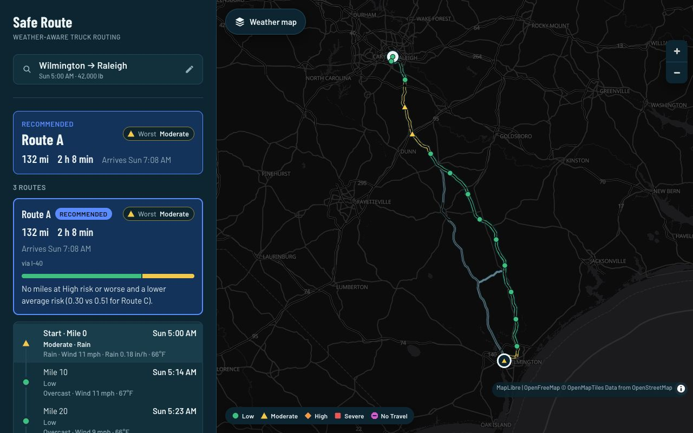
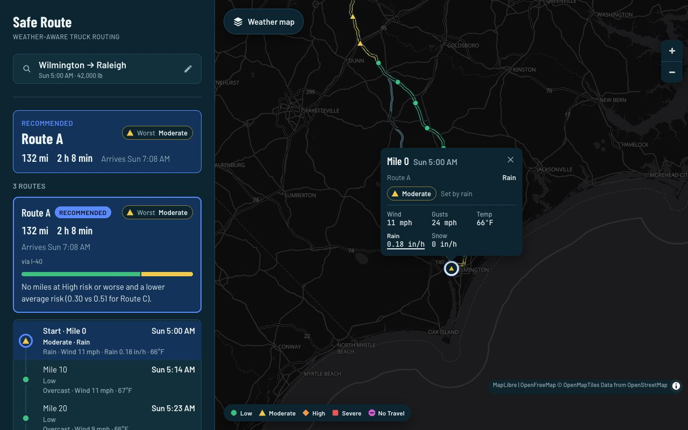
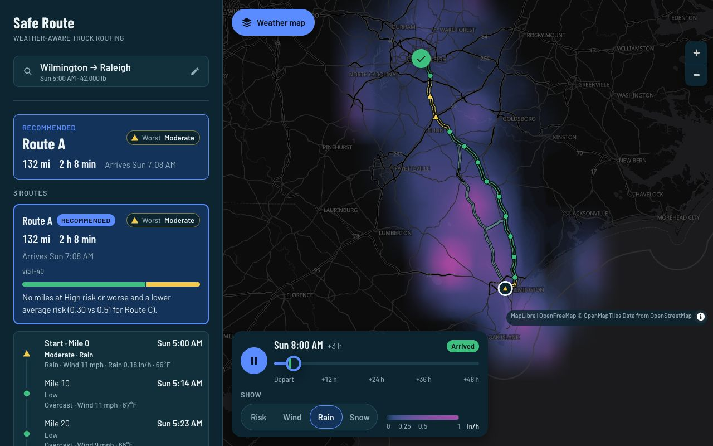
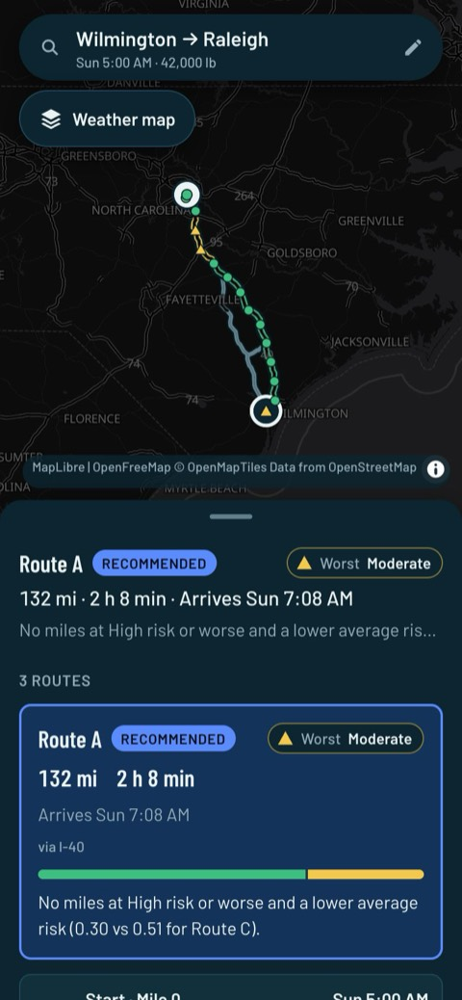

# Safe Route

Weather-aware route planning for truck drivers. Enter an origin, a destination, a departure time,
the cargo weight and how often to check the weather. Safe Route returns up to three truck routes
and forecasts the weather at checkpoints along each one for the hour the truck will be there. It
rates every checkpoint from Low to No Travel and recommends the route with the least exposure to
bad conditions. A corridor weather map with a 0–48 h slider shows how conditions move around the
trip while a truck marker follows the selected route.

**Walkthrough video:** https://www.loom.com/share/0c7a377fde9445b8ad7d4ba4e5c8b346

| Plan (desktop)                                                                       | Checkpoint detail                                                            |
| ------------------------------------------------------------------------------------ | ---------------------------------------------------------------------------- |
|  |  |

| Weather map with the forecast slider                                     | Mobile                                                     |
| ------------------------------------------------------------------------ | ---------------------------------------------------------- |
|  |  |

## Contents

- [Architecture](#architecture)
- [Risk rules](#risk-rules)
- [Recommendation](#recommendation)
- [External services](#external-services)
- [API](#api)
- [Run locally](#run-locally)
- [Tests](#tests)
- [Deploy](#deploy)
- [Limitations and trade-offs](#limitations-and-trade-offs)
- [Decisions](#decisions)

## Architecture

```
backend/    Django 5.2 + Django REST Framework (JSON API, no database)
frontend/   React 19 + TypeScript + Vite, MapLibre GL, Zustand
```

### Backend: one pipeline per plan

`POST /api/plan` runs a straight pipeline in `backend/routing_api/services/`. The views only
validate input (serializers) and map errors onto a single error shape.

```
routing.py      up to 3 truck routes, with cumulative time and distance per shape point
   ↓
checkpoints.py  a point every 10/25/50 mi (origin and destination included), each with its ETA
   ↓
weather.py      Open-Meteo hourly forecast at each checkpoint for the hour nearest its ETA
   ↓
risk.py         level per checkpoint: worst of wind, rain and snow, then the load rules
   ↓
planner.py      segment colours, miles per level, average risk, notices
   ↓
recommend.py    lexicographic ranking and a one-line reason for each rank
```

`risk.py` and `recommend.py` are pure functions with no I/O, which keeps the rules easy to read
and test. `planner.py` is the only module that knows the order.

`POST /api/heatmap` (`heatmap.py`) takes the planned route lines and builds a grid over the
corridor within 40 mi of any route. It fetches 49 hourly forecasts for each cell and classifies
every cell and hour with the same `risk.assess` used for checkpoints. The client only draws what
it receives; there are no risk rules in the front end.

### Frontend: MVVM

```
screens/TripPlanner/
  useTripPlannerViewModel.ts   the screen's ViewModel: form state, API calls, selection, playback
  useForecastViewModel.ts      a scoped ViewModel for the forecast slider and the map's hour/truck
  DesktopView.tsx              >= 768 px: side panel (360-400 px) + map
  MobileView.tsx               <  768 px: full-screen map + bottom sheet
  index.tsx                    picks the view by breakpoint; both receive the same ViewModel
components/                    props-only, typed, reusable (RouteList, CheckpointTimeline, MapView…)
stores/useTripStore.ts         Zustand: plan, selection, weather-map state; read through selectors
services/api.ts                fetch wrapper; one error type with a message safe to show
lib/                           pure helpers: formatting, risk display metadata, truck interpolation
```

The views hold JSX only. The two layouts render the same components from the same ViewModel and
differ in arrangement only.

The forecast slider changes several times a second during playback. It has its own scoped
ViewModel so that only the slider, the legend and the map subscribe to the hour. During a 10-hour
playback on desktop, the screen view went from 12 renders to 2 (play and pause), and the route
list and timeline from 12 to 0. The map and slider still render once per step.

The weather map is drawn as two MapLibre image layers. Each hour is interpolated bilinearly
between cell centres and painted into an image once. While playing, the next hour cross-fades in
over the current one and the truck marker glides along the route, so changing the hour never
rebuilds geometry.

## Risk rules

Units come straight from Open-Meteo: sustained wind at 10 m in mph, and rain and snowfall in
inches per hour. Rain is `rain + showers`. Open-Meteo's `precipitation` is not used, because it
also includes snowfall, which is rated separately.

| Level         | Wind (mph) | Rain (in/h)   | Snow (in/h) |
| ------------- | ---------- | ------------- | ----------- |
| Low (0)       | < 25       | < 0.10        | < 0.5       |
| Moderate (1)  | 25 – < 35  | 0.10 – < 0.25 | 0.5 – < 1.0 |
| High (2)      | 35 – < 45  | 0.25 – < 0.50 | 1.0 – < 2.0 |
| Severe (3)    | 45 – < 55  | 0.50 – 1.00   | 2.0 – 3.0   |
| No Travel (4) | ≥ 55       | > 1.00        | > 3.0       |

**Band edges.** The source table's bands touch (for example "25–35" and "35–45"). A value that
sits exactly on a shared edge goes to the higher level, which is the conservative reading. The
exceptions are the top edges of rain and snow Severe: the table states No Travel as "> 1.00" and
"> 3.0", so exactly 1.00 in/h of rain and 3.0 in/h of snow stay Severe.

**Checkpoint level.** The level is the worst of the wind, rain and snow levels. The factor that
set it is reported as `wind`, `rain` or `snow`; on a tie, wind wins over rain, and rain over snow.

**Load rules.** These are applied afterwards and can only raise the level. When one does, the
factor becomes `load` and `load_rule` names the rule.

| Sustained wind | Cargo       | Level     |
| -------------- | ----------- | --------- |
| ≥ 55 mph       | any         | No Travel |
| 45 – < 55 mph  | > 30,000 lb | No Travel |
| 35 – < 45 mph  | > 40,000 lb | Severe    |

Wind gusts are shown for context only and do not change the level.

**Along the route.** The miles between two consecutive checkpoints take the worse of their two
levels. `miles` sums the route's length by level. `avg_risk` is the mileage-weighted mean of the
numeric level, and `worst_level` is the highest level on the route.

## Recommendation

Routes are sorted by this key; smaller wins at the first criterion that differs:

```
(no_travel_miles, severe_miles, high_miles, avg_risk, duration_s)
```

Miles are compared rounded to 0.1 mi and average risk to 0.01, the precision the app displays.
A difference the driver cannot see therefore never decides the recommendation. Exposure to the
worst conditions comes first. Average risk separates routes that are equally clear of High risk.
Time only breaks ties between routes whose risk is the same.

Each route gets a `rank` and a `rank_reason` naming the criterion that decided it, for example:

- "The only route that avoids No Travel risk."
- "No miles at High risk or worse and a lower average risk (0.30 vs 0.51 for Route C)."
- "12 more miles in High risk than Route B."
- "Same risk as Route A but 38 min longer."

## External services

All services are public and keyless. Every request sends `User-Agent: safe-route/1.0`, which you
can override with `HTTP_USER_AGENT`.

| Service                                        | Used for         | Notes                                                                                                                            |
| ---------------------------------------------- | ---------------- | -------------------------------------------------------------------------------------------------------------------------------- |
| [Valhalla](https://valhalla1.openstreetmap.de) | Truck routes     | `costing: truck` with gross weight in tonnes (35,000 lb tare + cargo, capped at the 80,000 lb federal limit) and `alternates: 2` |
| [OSRM](https://router.project-osrm.org)        | Fallback routing | Used only if Valhalla fails. It is not truck-aware, and the response says so in `notices`                                        |
| [Photon](https://photon.komoot.io)             | Place search     | US, Canada and Mexico results listed first; cached 24 h                                                                          |
| [Open-Meteo](https://open-meteo.com)           | Hourly forecast  | Up to 100 locations per request, 4 requests in parallel                                                                          |

**Routing.**

- **Synthetic alternatives.** Valhalla often returns fewer than three alternatives. The planner
  then routes through via points offset sideways from the main route at 1/3 and 2/3 of its length,
  using 12% of the straight-line distance, on both sides. A candidate is dropped if it overlaps an
  existing route by more than 85%, or if it takes more than 40% longer than the fastest route.
- **Long trips.** The public Valhalla server refuses trips longer than about 1,500 km. Trips over
  925 straight-line miles are split at great-circle waypoints snapped to primary roads, routed leg
  by leg, and stitched back together.
- **ETAs.** Each checkpoint's ETA comes from Valhalla's per-maneuver times, not from distance at
  an average speed.
- **Budget and cache.** Routing has an 18 s budget. Routes are cached for 20 minutes per origin,
  destination and weight.
- **Fewer than three routes.** If fewer than three distinct routes exist, the API returns those it
  has and adds a notice.

**Weather and rate limits.**

- **Metering and snapping.** Open-Meteo's free tier is metered per location, at about 600 per
  minute and 5,000 per hour. Coordinates are snapped to a 0.1° grid (about 7 mi) and de-duplicated
  across routes before any request.
- **Coarser grid for long plans.** If a plan would still need more than 350 locations, the grid
  coarsens in 0.1° steps. Coarse cells stay on multiples of 0.1°, so they reuse the fine-grid
  cache.
- **Cache.** Forecasts are cached for 30 minutes per cell and hour. Each request window is padded
  by 3 h before and 12 h after, so re-planning with a later departure is mostly served from the
  cache.
- **Retries and budget.** HTTP 429 and 5xx responses are retried once, with backoff. Weather has
  a 12 s budget.
- **Heatmap grid.** The heatmap grid is the finest one that keeps the corridor within 250 cells.
  All 49 hours of one cell count as one location.
- **Lookups from the browser.** Open-Meteo meters each IP address, and a hosted server often
  shares its address with other apps. When the server's daily or hourly allowance is spent, it
  answers `502` with the forecast URLs it still needs in `weather_requests`. The front end fetches
  them from the visitor's own connection and repeats the request once, with the answers in
  `weather`. The server checks that each URL is one it would have built (same host, variables,
  units and grid cells) and still runs every risk rule itself. Relayed answers serve only that
  request and are never cached for other visitors.

When an upstream service fails, the API answers `502` with a message that explains what happened.

## API

All bodies are JSON with snake_case keys. Times are ISO 8601; responses use UTC.

### `GET /api/health`

```json
{ "status": "ok" }
```

### `GET /api/geocode?q=dallas`

`q` must be at least 2 characters.

```json
{
  "results": [
    { "label": "Dallas, Texas, United States", "name": "Dallas", "lat": 32.77627, "lon": -96.79686 }
  ]
}
```

### `POST /api/plan`

```json
{
  "origin": { "lat": 32.7763, "lon": -96.7969, "label": "Dallas, TX" },
  "destination": { "lat": 29.7604, "lon": -95.3698, "label": "Houston, TX" },
  "departure": "2026-11-22T08:00:00-06:00",
  "cargo_lb": 42000,
  "spacing_mi": 25
}
```

Validation rules:

- `spacing_mi` must be 10, 25 or 50.
- `weather` is optional and only used after a `502` that listed `weather_requests` (see
  [Errors](#errors)). It holds up to 8 `{"url": ..., "response": ...}` pairs, one per listed URL.
- `cargo_lb` must be between 0 and 80,000, the US federal gross weight limit.
- Origin and destination must be more than 1 mile apart.
- `departure` must be between one hour ago and seven days ahead, which is the forecast range.

Response (trimmed: one route, one checkpoint, one segment):

```json
{
  "departure": "2026-11-22T14:00:00Z",
  "cargo_lb": 42000,
  "spacing_mi": 25,
  "recommended_route_id": "A",
  "notices": [],
  "routes": [
    {
      "id": "A",
      "label": "Route A",
      "rank": 1,
      "recommended": true,
      "rank_reason": "Same risk as the other routes and the fastest, 38 min ahead of Route B.",
      "via": ["I-45"],
      "distance_mi": 239.9,
      "duration_s": 13500,
      "arrival": "2026-11-22T17:45:00Z",
      "risk": {
        "worst_level": "LOW",
        "avg_risk": 0.0,
        "miles": { "LOW": 239.9, "MODERATE": 0.0, "HIGH": 0.0, "SEVERE": 0.0, "NO_TRAVEL": 0.0 }
      },
      "geometry": { "type": "LineString", "coordinates": [[-96.79678, 32.77594], "…"] },
      "segments": {
        "type": "FeatureCollection",
        "features": [
          {
            "type": "Feature",
            "properties": { "level": "LOW", "from_mi": 0.0, "to_mi": 239.9 },
            "geometry": { "type": "LineString", "coordinates": ["…"] }
          }
        ]
      },
      "checkpoints": [
        {
          "index": 0, "mile": 0.0, "lat": 32.77594, "lon": -96.79678,
          "eta": "2026-11-22T14:00:00Z",
          "level": "LOW", "factor": "wind", "load_rule": null,
          "weather": {
            "wind_mph": 7.4, "gust_mph": 22.1, "rain_in_h": 0.0, "snow_in_h": 0.0,
            "temp_f": 62.5, "weather_code": 3
          }
        }
      ]
    }
  ]
}
```

- `via` lists the main roads in driving order. Route numbers are preferred, and spelled-out names
  are normalised, so "Interstate 45" becomes "I-45".
- `geometry` is simplified to at most 1,500 points per route.
- When a load rule raised a checkpoint's level, `load_rule` reads like "Wind 45 to under 55 mph
  with cargo over 30,000 lb".

### `POST /api/heatmap`

The request takes the plan's `departure`, the cargo, and the route lines as `[lon, lat]` pairs.
It accepts at most 3 routes. The departure may be up to 12 hours in the past, so a plan that is
already under way still gets its map.

```json
{ "departure": "2026-11-22T14:00:00Z", "cargo_lb": 42000, "routes": [[[-96.797, 32.776], [-95.370, 29.760]]] }
```

```json
{
  "departure": "2026-11-22T14:00:00Z",
  "cargo_lb": 42000,
  "grid": { "lat0": 29.0, "lon0": -97.6, "dlat": 0.2, "dlon": 0.2, "rows": 23, "cols": 16 },
  "cells": [27, 41, 42, 43, 44, "…"],
  "hours": ["2026-11-22T14:00:00Z", "2026-11-22T15:00:00Z", "…"],
  "values": {
    "risk":      { "scale": 1,    "frames": [[0, 0, 1, "…"], "…"] },
    "wind_mph":  { "scale": 1,    "frames": [[2, 4, 3, "…"], "…"] },
    "rain_in_h": { "scale": 0.01, "frames": [["…"]] },
    "snow_in_h": { "scale": 0.01, "frames": [["…"]] }
  }
}
```

- `cells` holds the row-major indices of the grid cells inside the corridor. Cell `i` is centred
  at `(lat0 + row·dlat, lon0 + col·dlon)`.
- `frames[h][k]` is the value of `cells[k]` at `hours[h]`, as an integer. Multiply by `scale` to
  get the real value. Integers keep 49 hours × 250 cells × 4 metrics small on the wire.

### Errors

Every error has the same shape. `field` is present when one input is at fault.

```json
{ "error": "Departure must be within the next 7 days (weather forecast range).", "field": "departure" }
```

- `400`: invalid input.
- `502`: an upstream service failed or ran out of time, for example "Weather forecast is
  unavailable right now. Try again shortly."
- `502` with `weather_requests`: the server's forecast allowance is spent. The list holds the
  Open-Meteo URLs still needed. A client may fetch them and send the same request again with the
  answers in `weather`. `POST /api/heatmap` accepts the same field.

## Run locally

Requirements: Python 3.14 and Node 22. No API keys are needed.

```bash
cd backend
python -m venv .venv && . .venv/bin/activate
pip install -r requirements.txt -r requirements-dev.txt
python manage.py runserver 8000
```

```bash
cd frontend
npm install
npm run dev
```

Open http://localhost:5173. In development the Vite server proxies `/api` to Django on port 8000,
so `VITE_API_URL` stays empty. The app also opens from a phone on the same network.

All settings have development defaults. `backend/.env.example` and `frontend/.env.example` list
every variable.

## Tests

```bash
cd backend && . .venv/bin/activate
python -m pytest -q && ruff check . && ruff format --check .

cd frontend
npx vitest run && npm run lint && npm run build && npm run format:check
```

Backend tests mock every external call with `respx`, so they need no network. The suites cover:

- the risk table, edge by edge;
- the ranking and its reasons;
- checkpoint placement;
- route parsing, stitching and fallbacks;
- weather batching, caching and retries;
- heatmap grids;
- the API contract.

Frontend tests cover the ViewModels, the store, components, the map layer helpers and the
formatters.

## Deploy

The API goes to Render as a free web service and the front end to Vercel. Both deploy from this
repository.

### 1. API on Render

1. In Render, choose **New → Blueprint** and connect the repository. Render reads `render.yaml`,
   which defines a Python web service with `backend/` as its root.
2. When Render asks for `CORS_ALLOWED_ORIGINS`, enter a placeholder such as
   `https://example.com`. You will set the real value in step 3.
3. Apply the blueprint. Render generates `DJANGO_SECRET_KEY`, sets `DJANGO_DEBUG=0`, installs
   `requirements.txt`, and starts gunicorn. It also adds its own hostname to `ALLOWED_HOSTS`
   through `RENDER_EXTERNAL_HOSTNAME`.
4. Check that `https://<service>.onrender.com/api/health` returns `{"status":"ok"}`.

### 2. Front end on Vercel

1. In Vercel, choose **Add New → Project**, import the repository, and set **Root Directory** to
   `frontend`. Vercel detects Vite, so the build command is `npm run build` and the output is
   `dist`.
2. Add the environment variable `VITE_API_URL=https://<service>.onrender.com`, with no trailing
   slash. Vite reads it at build time, so changing it later requires a redeploy.
3. Deploy. No `vercel.json` is needed, because the app is a single page that never changes the
   URL path.

### 3. Allow the front end to call the API

In Render, set `CORS_ALLOWED_ORIGINS` to the Vercel production origin, for example
`https://safe-route.vercel.app`. Use the exact origin with no trailing slash, and separate several
origins with commas. Saving the change redeploys the service.

Vercel preview deployments use other hostnames and are refused unless you add them.

### Production notes

- **Cold starts.** Render's free plan stops the service after about 15 minutes without traffic.
  The next request waits roughly a minute while it starts again, and that restart also empties
  the cache. Open `/api/health` before a demo.
- **Process model.** gunicorn runs one worker with 4 threads. Requests spend most of their time
  waiting on routing and weather services, so threads cover concurrency, and one process keeps a
  single in-memory cache.
- **Cache.** The cache is Django's `LocMemCache`. It needs no extra service and is shared by every
  thread of that one process, which is all a single free instance has. Running several processes
  or instances would call for Redis or Memcached, so that routes and forecasts are shared and the
  Open-Meteo allowance is not spent once per process.
- **HTTPS.** With `DJANGO_DEBUG=0`, Django trusts the proxy's `X-Forwarded-Proto`, redirects HTTP
  to HTTPS, and sends HSTS for 30 days. `/api/health` is exempt from the redirect so the
  platform's health check works.
- **Remaining `check --deploy` warnings.** `python manage.py check --deploy` reports three
  warnings, all expected:
  - `security.W003` (no CSRF middleware). The API has no cookies, sessions or forms. Every call is
    a cross-origin JSON request controlled by CORS, so there is no browser credential for CSRF to
    protect.
  - `security.W005` and `security.W021` (HSTS subdomains and preload). The service runs on a
    shared `onrender.com` hostname, and it cannot make promises for other subdomains of that
    domain or submit it to the preload list.

## Limitations and trade-offs

- **ETAs assume continuous driving**, with no rest breaks or hours-of-service limits. Long trips
  get a notice saying so.
- **Weather is the forecast for the hour nearest each ETA**, on a 0.1° grid (about 7 mi).
  Conditions between checkpoints are inferred from the two ends of each stretch. A short squall
  between two checkpoints 50 mi apart can be missed; 10 mi spacing narrows that gap.
- **Only wind, rain and snow are rated**, as the brief specifies. Ice, fog, visibility and
  temperature are shown but not rated.
- **Public demo servers.** Valhalla, OSRM, Photon and Open-Meteo are free services with rate
  limits and no uptime guarantee. A busy minute can cause a `502`, which the app explains.
  Trying again a moment later usually works, and much of the work is then served from the cache.
- **Weather quota on a shared host.** Open-Meteo counts requests per IP address, and the hosted
  API shares an outbound address with other apps on the same platform, so its daily allowance can
  run out early. When it does, the browser looks the forecast up on the visitor's own connection,
  as described under [External services](#external-services). If that connection's allowance is
  spent too, the plan fails with the server's message until the daily reset at 00:00 UTC.
- **The OSRM fallback is not truck-aware.** It is used only when Valhalla fails, and the plan says
  so.
- **Long trips get coarser weather.** On long trips the plan's weather grid and the corridor map
  coarsen to stay within the free allowance. Chicago to Denver uses 0.3° map cells, and Los Angeles
  to New York uses about 0.5°.
- **Single process and no database.** Nothing is stored, and the cache resets on every restart.

## Decisions

- **Conservative edges and segments.** A value on a shared band edge counts as the higher level,
  and a stretch between checkpoints takes the worse of its two ends. The app would rather warn
  too early than too late.
- **Exposure before averages.** A route with 5 miles of No Travel is never recommended over one
  with 50 miles of High, however much better its average looks.
- **Risk rules live only in Django.** That includes the heatmap, whose cells are classified on
  the server. The front end holds display metadata only: labels, colours and glyphs.
- **Gross weight for routing.** The truck profile gets tractor-trailer tare plus cargo, capped at
  80,000 lb, so weight-restricted roads and bridges are avoided for the actual load.
- **Synthetic detours.** The driver gets three real choices even where the routing engine offers
  one. Near-duplicates and long detours are filtered out instead of padding the list.
- **Integer-encoded heatmap frames.** A whole 48-hour corridor forecast arrives in one small
  response. After that the slider never waits on the network.
- **Scoped ViewModel for the forecast.** The one high-frequency piece of state has its own
  ViewModel, instead of re-rendering the whole screen on every playback step.
- **No database and no auth.** The app answers one question per request and stores nothing.
